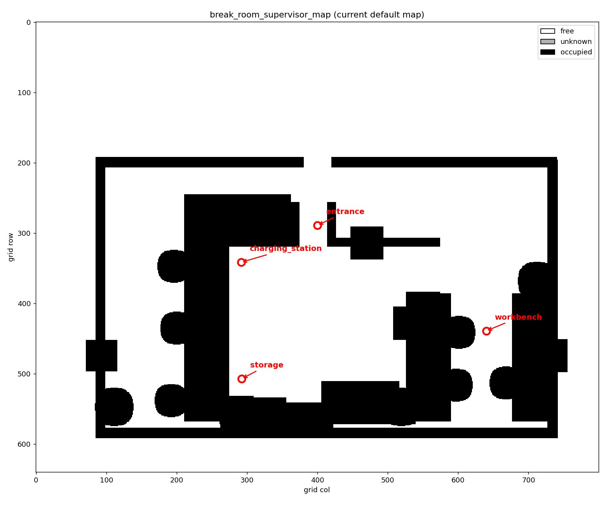

# LLM 辅助移动机器人任务规划

本仓库实现了面试作业 *LLM-Assisted Mobile Robot Task Planning*，
基于 Webots R2025a 与 ROS 2 Humble。系统将自然语言请求转换为一组少量、经过验证的高层机器人技能调用。
大语言模型只能从固定白名单中选择技能，不能直接发布速度指令，也不能执行生成的代码。

> 最新实验结果与指标见 [`RESULTS.md`](RESULTS.md) 第 0 节；完整中文技术报告见 [`report/report.pdf`](report/report.pdf)。


---

## 1. 系统概览
系统包含四层：

```text
自然语言请求
        │
        ▼
规划器 Planner（模拟规划器 或 兼容的 LLM 规划器）
        │ 原始计划 raw plan
        ▼
验证器 Validator（白名单、Schema、工作空间、步数限制）
        │ 通过验证的调用
        ▼
技能执行器 Skill Executor（navigate_to, follow_waypoints, stop）
        │ ROS 2 话题
        ▼
Webots + ROS 2（RoboMaster agent0）
        │ 结构化结果
        ▼
恢复 Recovery（重试 / 后退避障 / 有界重规划 / 停止）
        │
        └── ExecutionFeedback ──► Planner（重新规划）
        │
        ▼
JSONL 日志
```

已实现的技能：

1. `navigate_to(x, y, theta)` — 全向位置控制 + 最终航向对齐，带位置/航向容差与安全超时。
2. `follow_waypoints(waypoints)` — 依次访问一组航点，失败时报告最后到达的航点下标。
3. `stop()` — 发布零速度，并返回结构化结果。

每个技能至少返回：

```json
{
  "success": true,
  "reason": "reached",
  "elapsed_time_s": 7.81,
  "position_error_m": 0.049,
  "heading_error_rad": 0.000003
}
```

当前具名地点：

| 名称 | x | y |
|---|---|---|
| entrance | 0.0 | 3.0 |
| storage | -2.152373937677039 | -1.363206790893182 |
| workbench | 4.8 | 0.0 |
| charging_station | -2.17 | 1.95 |

工作空间边界：`x ∈ [-7.0, 7.0]`, `y ∈ [-4.0, 7.0]`。

当前运动与安全参数：

| 参数 | 数值 | 说明 |
|---|---|---|
| `v_max` | 2.25 | 最大线速度（m/s） |
| `omega_max` | 6.0 | 最大角速度（rad/s） |
| `obstacle_stop_distance` | 0.15 | 前方危险停车距离（m） |
| `wall_clearance_threshold` | 0.30 | 侧面离墙安全阈值（m） |
| `min_gap_width_m` | 0.45 | 最小可通过缝隙宽度（m） |
| `gap_check_distance_m` | 1.5 | 缝隙检测范围（m） |
| `min_traversable_clearance_px` | 0.15 m | A* 最小离障碍物距离 |

---

---

## 2. 环境配置与 Setup
参考环境：

| 组件 | 版本 |
|---|---|
| 操作系统 | Windows 11 Pro + WSL2 Ubuntu 22.04.5 |
| CPU | AMD Ryzen 7 7700 |
| GPU | AMD Radeon RX 9070 XT (16 GB) |
| 内存 | 32 GB |
| Python | 3.10.12（WSL） |
| ROS 2 | Humble |
| Webots | R2025a（Linux `.deb`，安装在 WSL 内） |
| `webots_ros2` | 2025.0.0 |
| `webots_ros2_robomaster` | 2025.0.0 |

详细安装记录（包括 WSLg OpenGL 验证和 Linux-Webots WSL 补丁）见 `docs/environment.md`。

### 2.1 WSL 配置与参考包下载

#### WSL 配置

1. 在 Windows 上安装 WSL2：

   ```powershell
   wsl --install -d Ubuntu-22.04
   ```

2. 在 Windows 用户目录（`C:/Users/<你的用户名>/.wslconfig`）中新建或修改 `.wslconfig`：

   ```ini
   [wsl2]
   guiApplications=true
   ```

3. 重启 WSL：

   ```powershell
   wsl --shutdown
   ```

4. 验证 WSLg 显示正常：

   ```bash
   echo $DISPLAY
   glxinfo -B | head -20
   ```

#### 安装 ROS 2 Humble

```bash
# 添加 ROS 2 仓库
sudo apt update
sudo apt install -y software-properties-common
sudo add-apt-repository universe
sudo apt update

# 安装 ROS 2 Humble Desktop
sudo apt install -y ros-humble-desktop

# 安装 colcon 与 rosdep
sudo apt install -y python3-colcon-common-extensions python3-rosdep2
sudo rosdep init
rosdep update
```

环境变量可在 `.bashrc` 中添加：

```bash
echo "source /opt/ros/humble/setup.bash" >> ~/.bashrc
```

#### 安装 Webots 与 webots_ros2

1. 从 Cyberbotics 官网下载 Webots R2025a 的 Linux `.deb` 安装包。
2. 在 WSL 中安装：

   ```bash
   sudo dpkg -i webots-R2025a.deb
   sudo apt --fix-broken install -y
   ```

3. 安装 `webots_ros2`：

   ```bash
   sudo apt update
   sudo apt install -y ros-humble-webots-ros2
   ```

#### 下载参考包 webots_ros2_robomaster

```bash
cd ~
git clone https://github.com/MohismLab/webots_ros2_robomaster.git
cd webots_ros2_robomaster

# 下载 protos/meshes 资源（Google Drive 文件夹）
gdown --folder 126Wyz2xYeYT01z5ilD1YH_fYc0rHBA_M
```

#### 安装 Webots 资源缓存

```bash
mkdir -p ~/.cache/Cyberbotics/Webots/assets
unzip assets-R2025a.zip -d ~/.cache/Cyberbotics/Webots/assets
```

详细说明见 `docs/environment.md`。
### 2.2 编译技能包

```bash
source /opt/ros/humble/setup.bash
cd ~/ros2_ws
colcon build --symlink-install --packages-select robot_skills
source install/setup.bash
```

验证：

```bash
ros2 pkg executables robot_skills
```

应看到：

```text
robot_skills follow_waypoints
robot_skills navigate_to
robot_skills stop_skill
```

### 2.3 可选的 Windows 原生 Webots 模式

默认模式在 WSL2 内运行 Webots。如果你想要更流畅的 GUI 渲染，可以在 Windows 上原生安装 Webots 作为对比。

Windows PowerShell：

```powershell
powershell -ExecutionPolicy Bypass -File scripts/setup_windows_webots.ps1 -Proxy http://127.0.0.1:7890
```

WSL 内：

```bash
# 应用两个驱动补丁（幂等，需要 root）
sudo python3 scripts/patch_webots_ros2_driver.py

# 启动仿真
bash scripts/start_robomaster.sh

# 停止仿真（同时停止 Windows Webots）
bash scripts/stop_robomaster.sh
```

驱动通过 WSL interop 启动 `D:/Webots/msys64/mingw64/bin/webots.exe`，并通过 TCP 端口 1234 连接。

---

## 3. 启动仿真
> **默认模式：** Webots R2025a 在 WSL2 内运行，路径 `/usr/local/webots`，通过 WSLg 显示。
> 环境文件会设置 `WEBOTS_HOME=/usr/local/webots`。可选 Windows 原生模式见 2.3 节。

交互式 WSL 终端：

```bash
source /opt/ros/humble/setup.bash
source ~/ros2_ws/install/setup.bash
export WEBOTS_HOME=/usr/local/webots
unset TMPDIR

ros2 launch webots_ros2_robomaster robot_launch.py
```

等待控制器连接：

```text
[agent0]: Controller successfully connected to robot in Webots simulation.
[agent1]: Controller successfully connected to robot in Webots simulation.
```

常用话题：

```text
/agent0/cmd_vel         geometry_msgs/msg/Twist
/agent0/gps             geometry_msgs/msg/PointStamped
/agent0/compass/bearing webots_ros2_msgs/msg/FloatStamped
/scan                   sensor_msgs/msg/LaserScan
/imu                    sensor_msgs/msg/Imu
```

---

## 4. 键盘操作
手动键盘遥控（可选）：

```bash
# 使用仓库自带键盘脚本
python3 scripts/keyboard_twist.py --topic /agent0/cmd_vel
```

或 ROS 2 标准键盘遥控：

```bash
ros2 run teleop_twist_keyboard teleop_twist_keyboard --ros-args -r cmd_vel:=/agent0/cmd_vel
```

---

---

## 5. 运行任务级代理（LLM）
代理可以使用确定性的模拟规划器（无需 API key），也可以使用兼容的 LLM 规划器。

> 说明：模拟规划器（MockPlanner）是不通过 LLM，而直接解析文本并指定路线的规划器。

```bash
cd /mnt/d/DS_workspace/Liqingbiao/assignment
source /opt/ros/humble/setup.bash
source ~/ros2_ws/install/setup.bash

# 成功用例
python3 -m agent.main "Go to storage." --log logs/success_storage.jsonl

# 多航点用例
python3 -m agent.main "Visit storage, then workbench, and stop." --log logs/success_visit.jsonl

# 非法地点
python3 -m agent.main "Go to space_station." --log logs/failure_invalid_location.jsonl

# 未知技能
python3 -m agent.main "Go to entrance and fly." --log logs/failure_unknown_skill.jsonl

# 超时 + 有界重试（测试辅助）
python3 -m agent.main "Go to charging_station." --nav-timeout 1 --max-retries 1 --log logs/failure_timeout.jsonl

# 超时 + 一次有界 LLM 重规划（仅当 --planner llm）
python3 -m agent.main "Go to charging_station." --planner llm --nav-timeout 1 --max-retries 1 --max-replans 1 --log logs/llm_replan_timeout.jsonl
```

最终结果以 JSON 打印，所有中间步骤写入 JSONL 日志：

```text
raw_plan
validation
skill_result
recovery_decision
skill_result
recovery_decision
feedback_to_planner    （仅当使用LLM 重规划时）
replanned_plan
validation
skill_result
final_outcome
```

### 5.1 可选真实 LLM 规划器

复制 `.env.example` 为 `.env` 并填入 key：

```bash
cp .env.example .env
```

`.env` 内容：

```text
OPENAI_BASE_URL=<your-api-url>
OPENAI_API_KEY=<your-key>
OPENAI_MODEL=gpt-5.5
```

`.env` 已被 gitignore，绝不能提交。

直接测试 API：

```bash
python3 scripts/test_llm_api.py
```

使用真实 LLM 规划器运行任务代理：

```bash
python3 -m agent.main "Go to storage." --planner llm --log logs/llm_success.jsonl
```

如果没有配置 key，或者 API 调用失败，`LLMPlanner` 会打印警告并回退到 `MockPlanner`（模拟规划器），因此系统其余部分仍可测试。

当使用 `--planner llm` 且导航技能在重试预算耗尽后仍然失败时，代理会把结构化执行结果发回 LLM，请求新计划。新计划会重新验证，重规划次数由 `--max-replans` 限制（默认 1）。模拟规划器不消费反馈，只使用规则式重试 / 后退避障 / 停止上报。

---

---

## 6. 基于地图的 A* 导航

### 6.1 推荐：Supervisor 精确建图

此方法通过 Webots Supervisor 直接读取场景中每个物体的真实位置、尺寸和旋转角度，生成的地图最接近实际仿真世界。

```bash
# 第一步：导出场景物体信息（会短暂启动一个专用 Webots 实例）
bash scripts/run_supervisor_export.sh

# 第二步：根据导出结果生成占据栅格地图
python3 scripts/build_map_from_supervisor.py
```

生成：

```text
maps/supervisor_objects.json
maps/break_room_supervisor_map.pgm
maps/break_room_supervisor_map.yaml
```

当前默认地图就是这张 `maps/break_room_supervisor_map.pgm`。



### 6.2 可选：激光扫描建图
可以使用真实 GPS、罗盘航向和 `/scan` 建立 2D 占据栅格地图：

```bash
python3 scripts/build_map.py --output maps/break_room_map --duration 240
```

生成：

```text
maps/break_room_map.pgm
maps/break_room_map.yaml
```

也可以直接使用世界文件几何结构生成全房间地图：

```bash
python3 scripts/build_map_from_world.py
```

生成：

```text
maps/break_room_world_map.pgm
maps/break_room_world_map.yaml
```

`navigate_to` 支持两种模式：

| 模式 | 运行方式 | 行为 |
|---|---|---|
| Direct | `--navigation-mode direct` | LLM 规划后直接 PID 控制 |
| Map | `--navigation-mode map` | LLM 规划后先 A* 规划，再由直接控制跟踪路径 |

示例：

```bash
python3 -m agent.main "Go to storage." --planner llm --navigation-mode map
python3 -m agent.main "Go to workbench." --planner llm --navigation-mode direct
```

LLM 规划器在任务层面保持不变：它仍然只选择 `navigate_to`、`follow_waypoints`、`stop`。地图只在技能层使用。未知与占据格视为不可通行；如果 A* 找不到路径，技能会回退到直接 PID 控制。

A* 规划器现在会：

- 给离墙/障碍物近的格子增加代价，优先选择通道中间路线；
- 将离障碍物小于 `0.15 m` 的格子视为不可通行，避免钻入狭窄缝隙；
- 路径直线简化时也要求全程保持最小离障距离。

如果仓库克隆到其他路径，请通过环境变量指定地图：

```bash
export ROBOT_MAP_PATH=/path/to/assignment/maps/break_room_supervisor_map.pgm
```

或在技能 CLI 中传入 `--map-path /path/to/break_room_supervisor_map.pgm`。

### 6.3 技能级 CLI

三个技能也可以直接测试：

```bash
ros2 run robot_skills navigate_to --x 0.0 --y -0.9 --theta 0.0 --timeout 20

ros2 run robot_skills follow_waypoints --waypoints '[{"x":0.0,"y":-0.9,"theta":0.0},{"x":0.5,"y":-0.5,"theta":0.0}]' --timeout-per-waypoint 20

ros2 run robot_skills stop_skill
```

### 6.4 障碍安全与缝隙检测

`navigate_to` 订阅 `/scan`，并执行多层安全检查：

1. **前方危险检测**：检查运动方向锥形区域，若最近有效距离小于 `obstacle_stop_distance`（默认 0.15 m），停车并返回 `obstacle_blocked`。
2. **窄缝隙检测**：估算前方自由缝隙宽度，若小于 `min_gap_width_m`（默认 0.45 m），认为无法通过并停车，避免机器人硬钻卡住。
3. **侧面离墙排斥**：实时检测左右激光间隙，任一侧小于 `wall_clearance_threshold`（默认 0.30 m）时，产生横向排斥速度并减速，使机器人任何时候都不过分贴墙。
4. **窄道自动减速**：左右间隙越窄，速度越低，最低降到原速度的 25%。

触发停车后，任务级代理执行有界恢复：

1. 后退 0.6 s；
2. 原地旋转 0.6 s；
3. 重试导航一次；
4. 如果重试仍被阻挡，停车并报告 `Target is blocked by an obstacle.`

激光测试工具在 `scripts/fake_scan.py`，它会在 `/scan` 上发布近距离 LaserScan。

---

---

## 7. 验证与安全
验证器实现六层检查：

1. 计划长度与最大步数；（max_steps）
2. 固定白名单：只允许 `navigate_to`、`follow_waypoints`、`stop`；
3. JSON Schema 类型、必填字段和范围检查；
4. 工作空间边界；
5. 技能前置条件；
6. 重试次数限制（默认 `max_retries=1`）。

LLM 从不被允许生成 Python、Shell 或 ROS 命令。执行器只把三个白名单技能名映射到 Python 方法。

### 7.1 有界恢复

| 失败类型 | 恢复动作 |
|---|---|
| 未知技能 | 拒绝计划，中止并上报 |
| 参数缺失 / 类型错误 | 拒绝计划，中止并上报 |
| 目标超出工作空间 | 拒绝计划，请求有效位置 |
| 导航超时 | 重试一次；再次失败则停止并上报 |
| 计划过长 | 拒绝计划，中止并上报 |

---

---

## 8. 仓库结构
```text
assignment/
├── README.md
├── RESULTS.md
├── .gitignore
├── agent/                       
│   ├── main.py                  # CLI 入口
│   ├── task_agent.py            # 整体流程控制
│   ├── models.py                # SkillCall, SkillResult, ExecutionFeedback 等
│   ├── registry.py              # 机器可读技能注册表 + JSON Schema
│   ├── validator.py             # 用于验证是否符合要求（白名单/Schema/工作空间/步数限制）
│   ├── executor.py              # 调用 robot_skills
│   ├── planner.py               # 模拟规划器（MockPlanner）和可选 LLMPlanner
│   ├── recovery.py              # 有上限的恢复策略
│   └── logger.py                # JSONL事件日志
├── tests/
│   └── test_task_agent.py       # 在没有Planner的情况下的整体测试
├── ros2_ws/src/robot_skills/    # Python技能包
│   ├── package.xml
│   ├── setup.py
│   └── robot_skills/
│       ├── skills.py            # RobotSkills 节点与技能实现
│       ├── navigate_to.py       # CLI的封装
│       ├── follow_waypoints.py  # CLI的封装
│       └── stop_skill.py        # CLI的封装
├── docs/
│   ├── architecture.md          # 架构图与数据流
│   ├── environment.md           # WSL2 / Webots / ROS 2 环境配置说明
│   └── report_materials.md      # 技术报告原始材料
└── logs/                        # 示例 JSONL日志
    ├── success_storage.jsonl
    ├── success_visit.jsonl
    ├── failure_invalid_location.jsonl
    ├── failure_unknown_skill.jsonl
    └── failure_timeout.jsonl
```
## 9.演示视频
视频Timeline：
0:00-0:05 预设位置的设定 
0:05-0:45 手动使用键盘控制机器人移动 
0:45-1:25 LLM驱动机器人执行任务。提示词为"Visit entrance, then charging_station, then storage, and stop." 

视频链接：https://youtu.be/YdCoMT8qiYI
